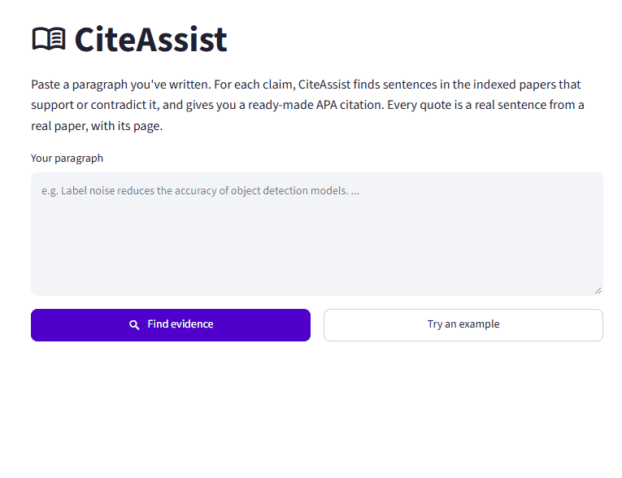
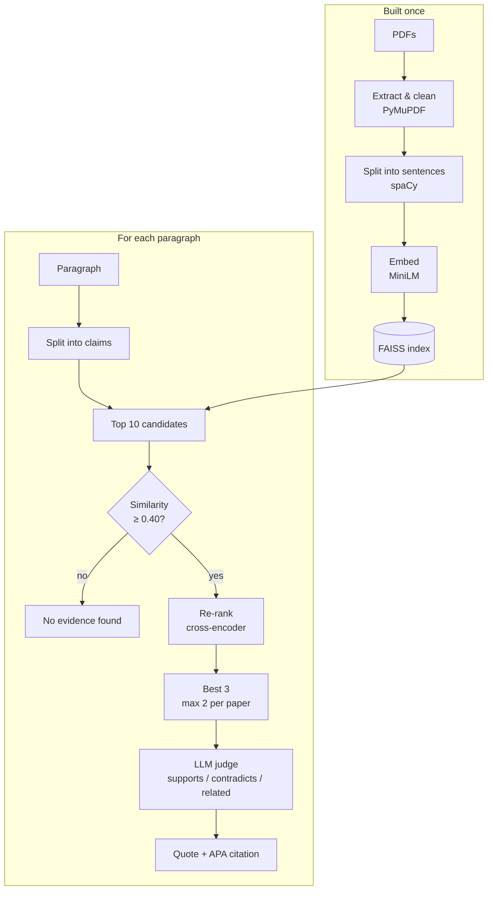

# CiteAssist

[](https://github.com/KalyniMenon/citeassist/actions/workflows/tests.yml)

**An AI research assistant that finds evidence for your claims in real research papers, and hands you the citation.**

Paste a paragraph you've written. For each claim in it, CiteAssist searches a collection of papers, finds the sentences that **support** or **contradict** it, and shows each one as an exact quote with its page and a ready-made APA citation.



## Why

Finding the right source for every statement in an essay or thesis takes hours of reading. And when people ask general chatbots for references, the chatbots often invent papers that don't exist.

CiteAssist only ever shows sentences that really appear in your papers, with the paper and page, so every suggestion can be checked. Two design principles:

1. **Quote, don't copy.** Evidence is always a quote with its citation, to help people cite properly rather than reuse others' words.
2. **Show both sides.** Contradicting evidence is shown as well as supporting evidence.

| | |
|---|---|
| **Your claim** | "Detectors such as Faster R-CNN remain fairly robust when many annotations are missing." |
| **Evidence found** | *"…after dropping 30% of the annotations (and labeling them as background), the performance of CNN-based object detectors like Faster-RCNN only drops by 5% on the PASCAL VOC dataset."* |
| **Label** | Supports: *"Faster-RCNN performance 'only drops by 5%' when annotations are dropped."* |
| **Citation** | (Wu et al., 2018, p. 1) |

## Results

Evaluated on a 49-claim test set built from randomly sampled sentences (details [below](#evaluation)):

| | Result |
|---|---|
| **End-to-end verdict accuracy**: is the verdict the user sees right? | **82%** (40/49, 95% CI 69–90%) |
| **False support on claims no paper supports** | **0 of 12** |
| **Label accuracy** of the LLM judge (claim + gold sentence) | **97%** (36/37) |
| **Recall@3**: exact gold sentence in the top 3 | 41% → **54%** with cross-encoder re-ranking |

Full results: [`results/eval_results.md`](results/eval_results.md) · per-claim details and failure reasons: [`results/eval_details.csv`](results/eval_details.csv)

## How it works



1. **Ingest** (`src/ingest.py`). PyMuPDF extracts text page by page. Running headers, page numbers, arXiv stamps, author lists, captions, acknowledgements and the reference list are removed; hyphenated line breaks are joined; spaCy splits the text into sentences, each kept with its paper and page.
2. **Index** (`src/index.py`). Every sentence is embedded with `all-MiniLM-L6-v2` (normalised, so inner product = cosine similarity) and stored in a FAISS `IndexFlatIP`. Exact search is fast enough for a few thousand sentences.
3. **Claims** (`src/claims.py`). The paragraph is split into one claim per sentence; citation markers like `[3]` or `(Wu et al., 2018)` are stripped before searching.
4. **Retrieve** (`src/retrieve.py`). Top 10 candidates from FAISS → drop those below the similarity threshold → re-rank with `cross-encoder/ms-marco-MiniLM-L-6-v2` → keep the best 3, at most 2 per paper. The threshold decides *whether* there is evidence; the cross-encoder only decides the *order*.
5. **Judge** (`src/judge.py`). One LLM request per claim labels each sentence *supports*, *contradicts* or *related*, with a one-line reason. Temperature 0, JSON validated, retried once, then falls back to *related*, so a broken reply never claims support. Rate limits are retried with backoff; answers are cached. The claim and sentences are passed as tagged data and the prompt says to ignore instructions inside them (PDF text is untrusted). Gemini by default; Groq or a local Ollama model also work.
6. **Cite** (`src/cite.py`). APA 7 in-text citations, e.g. *(Li et al., 2020, p. 5)*, and a reference list from `data/papers.csv`.
7. **App** (`app.py`). Streamlit: a verdict per claim, colour-coded labels, quotes, reasons and citations, a downloadable report. Models load once (`st.cache_resource`); without an LLM the app still shows evidence and citations.

**Why sentences, not chunks?** Citations need precise evidence. A chunk would point to a vague area of a paper; a sentence is a quote you can check and cite. The cost is context: see [failure analysis](#failure-analysis).

## Evaluation

```bash
python evaluate.py template   # sample sentences for a test set
python evaluate.py check      # validate data/test_claims.csv
python evaluate.py run        # run everything; writes results/
```

### The test set

[`data/test_claims.csv`](data/test_claims.csv): **49 claims**, 37 with evidence (27 supports, 7 contradicts, 3 related) and 12 with **no evidence** in the papers.

- **Randomly sampled.** Gold sentences were sampled at random, evenly across papers, rather than hand-picked, because hand-picked claims tend to be the easy ones. Unusable sentences (equations, captions, pure setup details) were removed.
- **Paraphrased.** Every claim is written in different words from its sentence, as a real user would write it. Contradicts claims state the opposite of the sentence.
- **Hard negatives.** The 12 no-evidence claims are *on topic* (segmentation masks, active learning, LiDAR, annotator pay…), and each was searched to confirm no paper covers it. Off-topic claims would be far too easy.
- **Not used for tuning.** The judge prompt was developed on separate claims, and the threshold was set beforehand and not re-tuned on this set.
- The claims were drafted with AI assistance from the sampled sentences; I reviewed and corrected every label.

### Metrics

| Metric | Embeddings only | With re-ranking |
|---|---|---|
| Recall@1 | 30% (11/37) | 32% (12/37) |
| **Recall@3** | 41% (15/37) | **54% (20/37)** |
| Candidate recall@10 (ceiling for re-ranking) | 68% (25/37) | 68% (25/37) |

| End to end (verdict the user sees) | Correct |
|---|---|
| Supports claims → *Supported* | 78% (21/27) |
| Contradicts claims → *Contradicted* | 71% (5/7) |
| Related claims → *Only related evidence* | 67% (2/3) |
| No-evidence claims → *No evidence* or *only related* | **100% (12/12)** |
| **All claims** | **82% (40/49)** |

When the judge says *supports* about a gold sentence it was right 100% of the time (26/26); *contradicts*, 100% (7/7).

### What the numbers show

- **Verdict accuracy (82%) is far above recall@3 (54%).** Recall only credits the exact gold sentence; in many "misses" the system showed a different sentence that supports the claim just as well (papers often repeat a finding in the abstract, introduction and results).
- **The LLM judge, not the threshold, handles claims with no evidence.** On-topic unsupported claims score 0.58–0.73 against the papers, overlapping real matches (0.64–0.86). No threshold separates them: at 0.40 retrieval alone gets 0/12 right; raising it to 0.70 gets 11/12 but hides 24% of real evidence. With the judge labelling their evidence *related*, the full system got 12/12.
- **Re-ranking helped 7 claims and hurt 2.** Recall@3 rose from 41% to 54%, but with 37 claims this is not statistically significant (McNemar p ≈ 0.18); a larger test set would be needed to confirm it.
- **The judge is better on clear cases than borderline ones.** It was 97% accurate on gold pairs, but its errors in the end-to-end run were on borderline sentences retrieval surfaced (e.g. reading "*mitigates localization noise*" as support for "*only* helps with localization noise"). The 82% end-to-end figure is the honest one.

### Prompt iteration

The judge prompt was developed on 3 separate claims (not in the test set):

| Version | Change | Result on the 9 development sentences |
|---|---|---|
| v1 | Labels + "judge only what the sentence says" | 1 false support: an off-topic sentence accepted by inventing a word ("handling") |
| v2 | "Same cause and effect"; "don't reinterpret"; reasons must quote the sentence | Fixed it, but over-corrected: 2 new errors |
| v3 | "General findings cover the claim's examples"; "contradicts needs the opposite effect" | All 9 correct |

Changing the prompt bumps `PROMPT_VERSION`, so cached answers from an older prompt are never reused.

### Failure analysis

Every failed claim has a reason in `results/eval_details.csv`. The main causes (a claim can have more than one):

| Cause | Claims | Example |
|---|---|---|
| **Context lost at sentence level** | 5 | "*This degradation is particularly evident…*": *what* degrades is in the previous sentence |
| **Vocabulary / jargon mismatch** | 4 | "*sufficient IoU values*" vs "*overlap well*"; "*synergistic effects*" vs "*amplify each other*" |
| **Re-ranker dropped the gold** | 4 | Embeddings had it in the top 3; the cross-encoder preferred another sentence |
| **Negated or definition claims** | 2 | Hard to match by meaning |
| **Equivalent evidence shown instead** | 4 | Same finding stated on another page (counted as a recall miss, verdict still right) |
| **Judge too strict or lenient** | 3 | False support, lenient reading, and one debatable contradiction |

## Limitations

- **Sentences lose their context.** The largest single cause of failures: sentences starting "*This…*" or "*Our method…*" can't be matched or judged on their own.
- **Small embedding model.** MiniLM doesn't connect jargon and acronyms (FSOD, IoU) to everyday paraphrases; about a third of gold sentences never reach the top 10 candidates.
- **One-sided evidence.** When papers disagree, the system can find support and miss the contradiction (it then says *supported* instead of *contested*).
- **PDF extraction is imperfect.** Occasionally two sentences or a caption are merged; scanned PDFs (no text layer) aren't supported. Page numbers are PDF pages, which can differ from a journal's printed page numbers.
- **Small test set, one annotator.** 49 claims gives wide confidence intervals, and the labels reflect one person's judgement.
- **Free-tier LLM.** The app checks up to 15 claims per run to stay within free-tier rate limits.
- **APA only**, with titles used as written in `papers.csv`.

## Next steps

1. **Embed each sentence with its neighbour** (still showing only the sentence), aimed at the biggest failure cause.
2. **Hybrid search**: add BM25 keyword search for jargon and acronyms.
3. **Search for both sides**: also search the negated claim, so contradicting evidence isn't missed.
4. **Try a larger embedding model**, measured with the same evaluation.
5. **Version 2, a citation checker**: verify existing citations in a draft by reusing `retrieve.py` and `judge.py`.
6. A larger test set with a second annotator, to measure agreement.

## Quickstart

Requires Python 3.10+.

```bash
python -m venv .venv
source .venv/bin/activate          # Windows: .venv\Scripts\activate
pip install -r requirements.txt
python -m spacy download en_core_web_sm
cp .env.example .env               # then add your key (Windows: copy .env.example .env)
```

1. **Papers.** Download each paper listed in `data/papers.csv` into `data/papers/`, named as in the `file` column (PDFs aren't committed). Add rows for your own papers; authors go as `Surname, Given names` separated by `;`.
2. **Build the index:**
   ```bash
   python -m src.ingest
   python -m src.index build
   ```
3. **LLM key.** Get a free Gemini key from [Google AI Studio](https://aistudio.google.com/apikey) and put it in `.env` as `GEMINI_API_KEY=...`. Or set `LLM_PROVIDER=groq` (with `GROQ_API_KEY`) or `LLM_PROVIDER=ollama` (local, no key). `LLM_MODEL` overrides the default model.
4. **Run the app:**
   ```bash
   streamlit run app.py
   ```

Command-line tools, each with `--help`:

```bash
python -m src.index search "claim" -k 5          # raw embedding search
python -m src.retrieve --compare "paragraph"      # with vs without re-ranking
python -m src.pipeline "paragraph"                # full pipeline in the terminal
python -m src.pipeline --no-judge "paragraph"     # no API calls
```

## Tests

```bash
python -m pytest -q
```

99 tests, all offline (no models downloaded, no API key needed), and run on every push by GitHub Actions. Stand-in encoders, re-rankers and LLMs replace the real models. Highlights:

- `test_ingest.py` builds a deliberately messy two-column PDF (headers, page numbers, hyphenation, a sentence across a page break, captions, acknowledgements, references) and checks each cleaning rule.
- `test_judge.py` checks JSON validation, retries, the fallback, caching, prompt-injection tags and each provider's HTTP request format.
- `test_app.py` drives the Streamlit app headlessly with `AppTest`: clicks buttons and checks what's on the page.
- `test_evaluate.py` checks every metric on small cases with known answers.

## Project structure

```
citeassist/
├── app.py                 # Streamlit app
├── evaluate.py            # test-set template, metrics, threshold sweep, failure list
├── src/
│   ├── ingest.py          # PDFs -> clean sentences with paper + page
│   ├── index.py           # embeddings + FAISS index, search
│   ├── claims.py          # paragraph -> claims
│   ├── retrieve.py        # threshold, cross-encoder re-ranking, per-paper cap
│   ├── judge.py           # LLM labels: supports / contradicts / related
│   ├── cite.py            # APA references and in-text citations
│   └── pipeline.py        # claims -> evidence -> labels -> citations
├── data/
│   ├── papers.csv         # paper metadata (PDFs go in data/papers/, not committed)
│   └── test_claims.csv    # evaluation test set
├── results/               # eval_results.md, eval_details.csv
├── tests/                 # 99 offline tests
├── .streamlit/config.toml # app theme
└── .env.example           # LLM settings (copy to .env)
```

## Papers indexed

- Li, J., Xiong, C., Socher, R., & Hoi, S. (2020). *Towards Noise-resistant Object Detection with Noisy Annotations* [Preprint]. arXiv. https://doi.org/10.48550/arXiv.2003.01285
- Mao, J., Yu, Q., Yamakata, Y., & Aizawa, K. (2021). *Noisy Annotation Refinement for Object Detection* [Preprint]. arXiv. https://doi.org/10.48550/arXiv.2110.10456
- Ryoo, K., Jo, Y., Lee, S., Kim, M., Jo, A., Kim, S. H., Kim, S., & Lee, S. (2023). *Universal Noise Annotation: Unveiling the Impact of Noisy Annotation on Object Detection* [Preprint]. arXiv. https://doi.org/10.48550/arXiv.2312.13822
- Wu, Z., Bodla, N., Singh, B., Najibi, M., Chellappa, R., & Davis, L. S. (2018). *Soft Sampling for Robust Object Detection* [Preprint]. arXiv. https://doi.org/10.48550/arXiv.1806.06986
- Xu, M., Bai, Y., & Ghanem, B. (2019). Missing Labels in Object Detection. In *Proceedings of the IEEE/CVF Conference on Computer Vision and Pattern Recognition (CVPR) Workshops*.
- Zhang, H., Chen, F., Shen, Z., Hao, Q., Zhu, C., & Savvides, M. (2020). *Solving Missing-Annotation Object Detection with Background Recalibration Loss* [Preprint]. arXiv. https://doi.org/10.48550/arXiv.2002.05274
- Zhou, Y., Li, J., Li, J., Huang, J., Nie, Q., Liu, Y., Gao, B.-B., Wang, Q., Heng, P.-A., & Chen, G. (2023). *Distribution-Aware Calibration for Object Detection with Noisy Bounding Boxes* [Preprint]. arXiv. https://doi.org/10.48550/arXiv.2308.12017

## License

[MIT](LICENSE)
